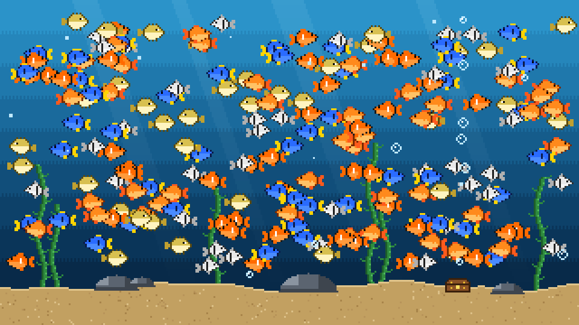

# fishbowl

An 8-bit aquarium for testing things in the browser: first 2D renderers, then the players that fish in it.

**Live: [fishbowl.jsnwng.dev](https://fishbowl.jsnwng.dev/)**. The experiments are at [`/renderers/`](https://fishbowl.jsnwng.dev/renderers/) and [`/players/`](https://fishbowl.jsnwng.dev/players/).



On the renderers page, the same seeded fish swim through the same frames under six different renderers. Add fish until it lags, run timed tests, and compare the numbers.

## Renderers

| Renderer | How it draws the bowl |
|---|---|
| `canvas2d` | Raw Canvas2D, one `drawImage` call per fish. This is the baseline. |
| `webgl` | Raw WebGL2, with every fish in a single instanced draw call. |
| `pixi` | PixiJS v8, one `Sprite` per fish. |
| `konva` | Konva's scene graph on Canvas2D, one cropped `Konva.Image` per fish. |
| `two` | Two.js on its WebGL renderer, one `Two.Sprite` per fish. |
| `p5` | p5.js v1 in instance mode. |

Each renderer is a small adapter behind the same interface (`init`, `setCount`, `update`, `render`, `destroy`). Adapters are loaded with a dynamic import, so each library ends up in its own bundle chunk. The bench drives every renderer from a single `requestAnimationFrame` loop rather than the library's own ticker.

## Benchmark

- **Run 10s:** a 2-second warmup, then 10 seconds measured at the current fish count.
- **Ramp:** starts at 500 fish and multiplies the count by 1.25 every 2 seconds, stopping once the p95 frame time passes 18 ms. It reports the highest count that held.
- **Run all / ramp all:** runs every renderer in turn, tearing each one down before the next.

Each run measures average FPS, p50/p95/p99 frame time, dropped frames (against the detected refresh rate), CPU time per frame, sim time, load and init time, time to first frame, JS heap peak, heap leaked after teardown, and gzipped bundle size per renderer. Results are saved locally and can be exported as JSON or CSV.

The comparison is kept fair on purpose:

- The sim advances one fixed tick per frame from a seeded RNG, so every renderer is handed identical frames.
- Fish flee the cursor in free play, but live input is switched off during benchmark runs.
- The dev server, the preview server and the live site all send cross-origin isolation headers, so `performance.now()` resolves to about 5 µs instead of 100 µs.

## The fisherman

[`/players/`](https://fishbowl.jsnwng.dev/players/) is a fishing game built on the same bowl, drawn with PixiJS. You get 2 minutes to catch as many points as you can. Rare fish are worth more, and they're faster or more skittish.

The rules make sure casting once and waiting doesn't pay:

- A splash scares nearby fish, so you have to cast where a fish is going, not where it is.
- A nibble gives you about 0.4 seconds to reel. Miss it and the fish takes the bait.
- Bait goes stale after a few seconds, so you have to recast.
- Fish change direction and depth now and then, so leading one is a guess, not a calculation.

Anything that implements the `Hunter` interface in [`src/game/types.ts`](src/game/types.ts) can play: it gets an observation and returns an action. Right now that's you, a hand-written heuristic, a small neural network trained to copy it, a cast-and-wait baseline, and a random baseline.

Hunters are asked at decision points, not every tick: whenever the line changes state, and every half second otherwise. That's about 200 asks per run, few enough for a language model to keep up, and the same chances for every hunter. A hunter can answer right away or return a promise. In **real time** the game keeps going while it thinks, so a late answer can miss its moment. In **turn based** the game waits, so only the quality of the decision counts.

The game itself is headless and deterministic: the same seed and the same actions always give the same run. So `npm run score` can play every hunter over many seeds in a few seconds:

```
hunter          catches        points
heuristic        13.9 ± 3.3    37.1 ± 7.0
model            13.7 ± 2.9    33.0 ± 9.6
cast and wait     6.7 ± 2.6    12.6 ± 6.4
random            1.4 ± 1.4     2.0 ± 2.3
```

All the numbers that tune the game are in [`src/game/rules.ts`](src/game/rules.ts).

The page keeps a results table of finished runs: catches and points, plus how many times the hunter was asked, its think time (p50 and p95), how late its answers landed (lag, in ticks), and frame time while it played. Any run can be replayed exactly, or exported as a small JSON file (a seed and a list of actions) and loaded back later.

### How the heuristic works

A heuristic is a rule of thumb: a shortcut a person writes down that's usually good enough. Nothing is learned and no data is involved, it's just judgment turned into if-statements. The fisherman's heuristic in [`src/game/hunters/heuristic.ts`](src/game/hunters/heuristic.ts) comes down to five rules:

1. When the line is in, pick the calm fish worth the most points per second of effort.
2. Cast where that fish will be, not where it is, plus a little extra so the splash just misses it.
3. When something bites, reel immediately.
4. When the bait is mostly stale, reel in and recast.
5. When nothing has come near the hook for a while, reel in and try somewhere else.

It's strong because it never hesitates and its aim is decent math. It can be beaten because it only knows what someone thought to write down. It assumes fish keep swimming straight, and they don't always. The thresholds in it are educated guesses, not proven best values.

### How the model works

The model is a small neural network that learned by watching the heuristic play, trained in Python in [`training/`](training/). Nobody wrote its rules: it saw about 34,000 of the heuristic's decisions from 160 games and learned to make the same ones. It has three layers and about 7,300 weights, and the browser runs it in plain TypeScript in [`src/game/hunters/clone.ts`](src/game/hunters/clone.ts), with no ML library, in about 20 microseconds a decision.

The first version had to say exactly where to cast, and it caught about 9 fish to the heuristic's 14, while matching 96% of its choices. All of the gap was aim. When two fish both looked good, it cast between them, into empty water. So the job is split: the network decides when to cast and which of the 5 nearest fish to go after, and the heuristic's aiming code drops the hook. That version catches about 14.

## The art

There are no image files. The fish are ASCII pixel maps in [`src/sprites.ts`](src/sprites.ts): five species built from three hand-drawn shapes plus palette swaps. The tail-wag frames and left-facing versions are generated, and everything is packed into a single sprite atlas that all six renderers share. The scenery in [`src/scenery.ts`](src/scenery.ts) is painted in code as well.

## Run it

```bash
npm install
npm run dev
```

For numbers worth comparing, use the production build, which also writes the gzip sizes:

```bash
npm run build
npm run preview
```

Then keep a single tab open, close DevTools, and plug your laptop in.

## Layout

```
src/
  adapters/     one file per renderer, plus the shared interface
  sim.ts        seeded fish and bubbles, cursor flee behavior
  sprites.ts    pixel maps, palettes, atlas builder
  scenery.ts    background painter
  runner.ts     render loop, renderer switching, run and ramp
  metrics.ts    frame stats, percentiles, heap sampling
  main.ts       renderers page wiring
  nav.ts        the site's sections, shared by every page's header
  game/         the fisherman: headless game, rules, hunters, PixiJS view
  story/        the home page's script
index.html      the home page: a card for each section
renderers/
  index.html    the renderer benchmark
players/
  index.html    the fisherman game
public/story/   screenshots for the home page
scripts/
  bundle-sizes.mjs   gzip size per renderer, from the Vite manifest
  score.ts           plays every hunter headless over many seeds (npm run score)
```

Each page is its own Vite build (`vite build`, then `--mode players` and `--mode story`), so the pages don't share chunks and the benchmark's bundle sizes stay its own.

Built with Vite and TypeScript.
